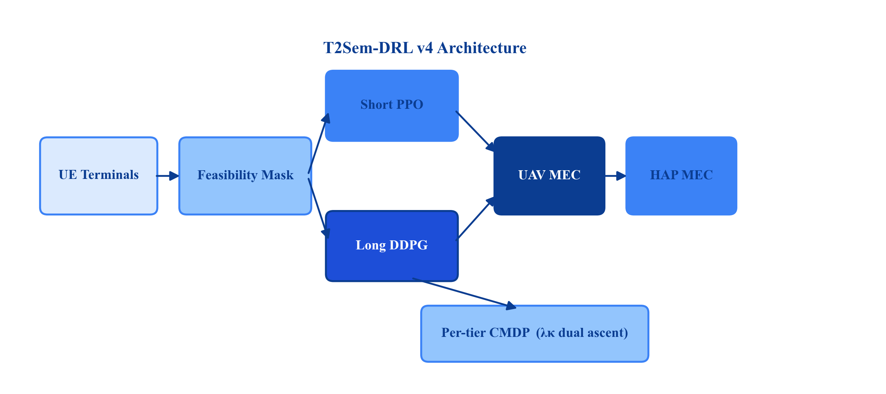
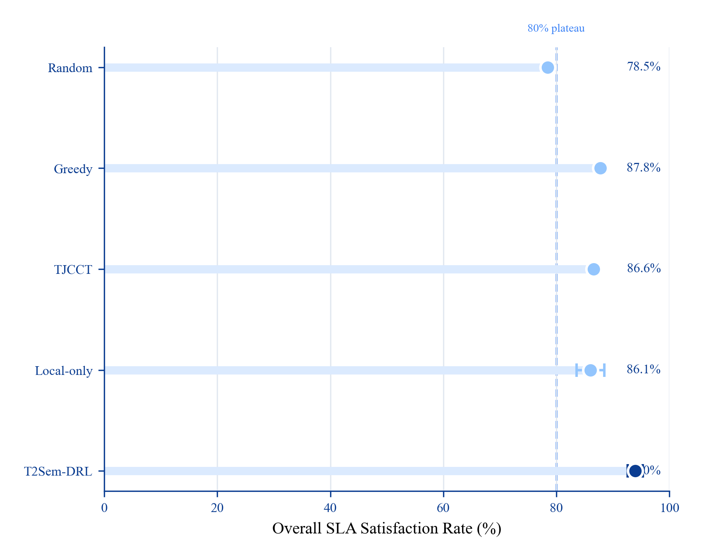
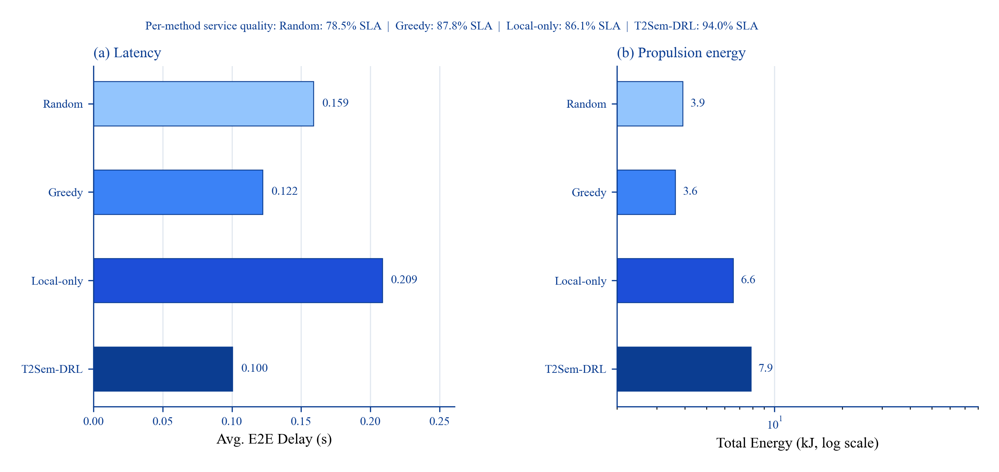
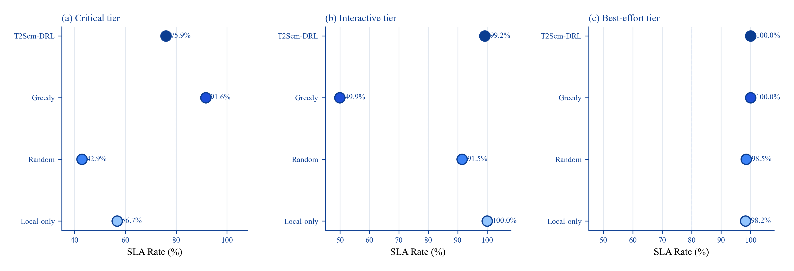
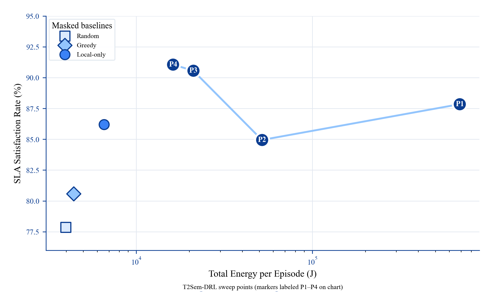
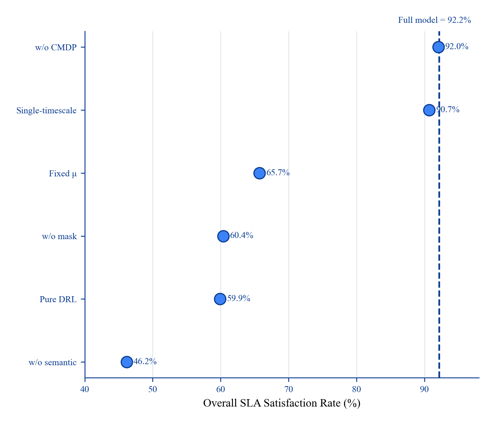
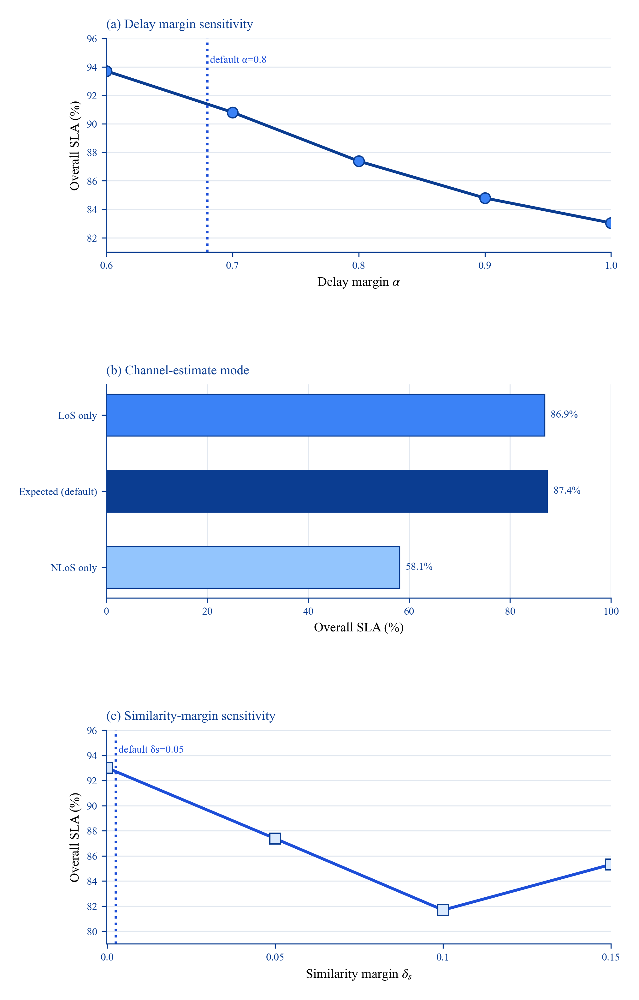
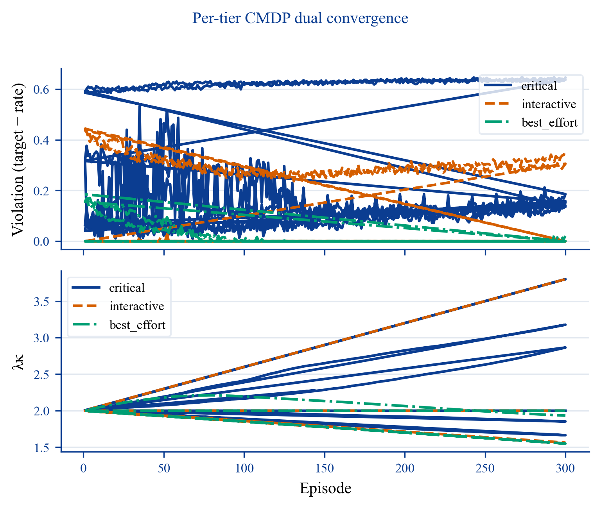

# T2Sem-DRL: Per-Tier Constrained Semantic Offloading with Model-Informed Feasibility in Multi-UAV Hierarchical MEC

**Full Manuscript Draft v4.3 (Major Revision)** — IEEE TMC / TVT / TWC target  
**Authors:** Jiashang Shen  
**Affiliation:** Wenzhou Kean University, Wenzhou, China  
**Email:** shenjias@kean.edu  
**Code:** `t2sem-mec-v2/` | **Config:** `configs/improved_v4_pertier.yaml`  
**Figures:** `figures/fig0`–`fig8` | **Data:** `data/` | **BibTeX:** `references.bib`

---

## Abstract

Hierarchical UAV–high-altitude platform (HAP) semantic MEC must satisfy **tier-heterogeneous SLAs** under stochastic air-ground channels. We show the main failure mode is not missing DRL complexity, but **infeasible offload actions** and **tier starvation** in continuous control.

We contribute a **model-informed offloading interface** and an **empirical contribution decomposition** (not a new RL backbone): (1) feasibility projection $\mathcal{F}$ shared by all policies, (2) semantic-aware hierarchical delay/similarity model, and (3) optional masked PPO inside $\mathcal{F}$. Under the canonical protocol (3 seeds × 30 eval episodes), T2Sem-DRL reaches **93.99±1.74%** SLA vs. **87.77±0.07%** for masked greedy (**+6.22 pp**), with mean delay **0.100 s**. Ablation quantifies lever size: semantic model **+46.0 pp**, feasibility mask **+31.8 pp**, RL refinement **+6.2 pp**. Per-tier duals are diagnostic (not aggregate-SLA improving), and two-timescale DDPG is optional (93.99% vs. 88.85% single-timescale; Table I-b). A supplementary shared-interface semantic baseline (Semantic MAPPO + $\mathcal{F}$) reaches **91.43%** on canonical seeds (paired **+2.56 pp**, 95% CI [1.14, 4.41]); on expanded seeds {42,123,456,789,1011}, the paired gap narrows to **−0.25 pp** (95% CI [−3.35, 2.84])—two different RL backbones converge inside the same interface, evidencing that $\mathcal{F}$, not the RL architecture, is the dominant lever. A scale-up stress test (16 UEs / 32 terminals / 5 UAVs) closes the deployment triangle with matched-training semantic baseline: Greedy **71.03%**, Semantic **73.72%**, T2Sem **80.31%** (paired **+6.59 pp**, 95% CI [2.71, 11.61]).

We do **not** claim universal energy dominance or critical-tier dominance. Energy is reported as operating points, and mixed-tier gains come with a critical-vs-interactive trade-off (Table II, Section VII-H).

**Index Terms—** UAV, mobile edge computing, semantic communication, constrained Markov decision process, service-level agreement, task offloading, feasibility region, proximal policy optimization.

---

## I. INTRODUCTION

### A. Motivation and Application Context

Mobile edge computing (MEC) offloads computation-intensive workloads from user equipments (UEs) to edge servers, reducing end-to-end (E2E) latency relative to remote cloud execution [17]. Unmanned aerial vehicles (UAVs) extend MEC coverage in disaster response, rural broadband, and temporary event networks by acting as aerial relays with line-of-sight (LoS) dominance [1], [13]. High-altitude platforms (HAPs) further provide wide-area compute at altitudes of tens of kilometers, forming a **hierarchical aerial MEC** architecture: local UE $\rightarrow$ UAV $\rightarrow$ HAP [2], [8].

Concurrently, **semantic communication (SemCom)** transmits task-relevant feature representations rather than raw bits, controlled by a semantic compression ratio $\mu \in (0,1]$ [11], [20]. Lower $\mu$ reduces radio load but increases semantic extraction delay and risks violating minimum similarity requirements. Modern applications impose **heterogeneous SLAs**: emergency sensing (critical tier) demands sub-100\,ms latency and high similarity; interactive augmented reality (interactive tier) tolerates hundreds of milliseconds; best-effort analytics relax both constraints.

**Problem statement.** We study **semantic-SLA-aware task offloading** in a multi-UAV, multi-user, multi-terminal hierarchical semantic MEC system: at each time slot, every terminal decides (i) offload target among local CPU, a UAV, or a HAP, (ii) semantic ratio $\mu$, and (iii) bandwidth/CPU resource shares; at each long frame, UAVs update 3D trajectories. The objective is to maximize tier-aware SLA satisfaction while limiting UAV propulsion energy.

### B. Limitations of Prior Methods

**Convex and heuristic optimization.** Optimization-based MEC resource allocation methods [16], [17] provide useful structure but often assume known statistics and do not scale cleanly to high-dimensional stochastic dynamics with semantic tiers. TJCCT [5] decouples UAV trajectory (long timescale) from resource allocation (short timescale) via matching and convex optimization rather than end-to-end learning.

**Single-metric DRL offloading.** Multi-UAV DRL frameworks [1], [2] optimize delay, energy, or priority-weighted utility but not explicit multi-tier semantic SLAs. Semantic-aware MAPPO offloading [3], [4] and UAV semantic MEC [11], [21] lack hierarchical HAP cooperation, shared feasibility interfaces, and explicit multi-tier SLA reporting under identical protocols.

**Single-constraint Lagrangian RL.** Constrained MDP (CMDP) methods [14], [15] enforce expected-cost constraints via dual ascent. A **single** global Lagrange multiplier cannot simultaneously guarantee critical, interactive, and best-effort tiers when their feasible regions conflict: our per-tier evaluation (Table II, Fig. 4) shows greedy policies reach **91.6%** critical SLA but only **49.9%** interactive SLA.

**Continuous offload actions without feasibility.** Mapping a continuous offload preference to local/UAV/HAP targets yields many **structurally infeasible** decisions (e.g., local compute cannot meet critical 100\,ms deadline under nominal task size). Without model guidance, DRL wastes samples on actions that fail regardless of learning (pure DRL ablation: **59.9%** SLA, Appendix B).

### C. Technical Challenges

This work addresses three coupled challenges:

1. **Tier-heterogeneous QoS (C1).** Aggregate SLA optimization masks per-tier starvation. A policy can maximize overall satisfaction while failing an entire tier class.

2. **Semantic–offloading infeasibility (C2).** Continuous action spaces do not encode analytic delay/similarity limits. Under stochastic air-ground channels and $\pm 20\%$ task-size jitter, optimistic routing misses deadlines.

3. **Energy–SLA coupling via UAV mobility (C3).** Long-timescale trajectory learning consumes propulsion energy [1], [13]. When routing is resolved by feasibility projection, excessive UAV movement yields high energy without SLA gain.

### D. Proposed Framework and Positioning

**Paper type.** We position this work as an **interface + empirical insight** paper: the scientific advance is a reusable model-informed action interface ($\mathcal{F}$ + semantic dynamics) and quantified evidence of where gains originate, not a novel PPO/DDPG recipe. Standard RL components (masked PPO, optional DDPG, PPO-Lagrangian) implement policy search **inside** the interface; their incremental value is measured explicitly (+6.2 pp over masked greedy under the canonical protocol).

**Primary contribution** is a **model-informed per-tier semantic SLA interface**:

1. **Feasibility projection $\mathcal{F}$ (dominant lever).** Before execution, project actions onto analytic delay/similarity limits (Section IV-B). Removing $\mathcal{F}$ costs **31.8 pp** in the ablation protocol (60.39% vs. 92.17% full; Table IV). All baselines—including greedy, TJCCT-Lite, and random—share $\mathcal{F}$ for fair comparison. Conceptually, $\mathcal{F}$ acts as a **safety shield / action mask** grounded in domain physics rather than as a learned constraint layer.

2. **Semantic–offloading model (dominant lever).** Adaptive $\mu$ and remote load modeling contribute **+46.0 pp** over the no-semantic ablation (46.17% vs. 92.17%; Table IV). Without semantics, even RL cannot recover tier-critical feasibility.

3. **Masked PPO (secondary lever).** Within $\mathcal{F}$, learning improves masked greedy by **+6.2 pp** under the canonical protocol (93.99% vs. 87.77%; Table I) and lowers mean delay from **0.122 s** to **0.100 s**—meaningful but smaller than $\mathcal{F}$ and semantics.

4. **Per-tier CMDP diagnostics (supporting).** Independent $\{\lambda_\kappa\}$ does **not** improve aggregate SLA (single-$\lambda$ 92.80% vs. full 92.17%; Table IV) and can **reduce** critical-tier SLA relative to single-$\lambda$ (83.8% vs. 76.0%; Table II). We therefore treat per-tier dual ascent as a **tier-allocation diagnostic tool**, not a headline method contribution.

5. **Two-timescale DDPG (optional appendix-level module).** Under default load, single-timescale control reaches **88.85%** SLA at **4.1 kJ**, while the full two-timescale checkpoint reaches **93.99%** at **7.9 kJ** (Table I-b)—roughly **2× energy for ~5 pp SLA**. DDPG is retained only as an optional operating mode; the main paper narrative does not depend on it.

**Empirical contribution decomposition (ablation protocol; Table IV):**  
$\text{semantic }(+46.0\text{ pp}) > \text{mask }(+31.8\text{ pp}) > \text{RL over masked greedy }(+6.2\text{ pp})$. Per-tier $\lambda_\kappa$ modifies tier allocation without aggregate-SLA gain.



### E. Contributions

The main contributions are:

1. **Model-informed feasibility region $\mathcal{F}$** as a **reusable system-level action interface** (analytic shield / action mask) with delay margin $\alpha$, expected-channel estimation, and similarity headroom $\delta_s$ (Section IV-B; **+31.8 pp** when removed; Table IV).

2. **Hierarchical semantic MEC model** coupling $\mu$, three-way offloading, contention, and three-tier SLAs (**+46.0 pp** when semantics is removed; Table IV).

3. **Empirical contribution decomposition** under a shared-mask protocol: quantifies that domain modeling and feasibility projection dominate SLA gains, while masked RL provides a secondary **+6.2 pp** refinement (Tables I, IV–V).

4. **Tier-aware evaluation and diagnostics:** per-tier SLA reporting, $\lambda_\kappa$ trajectories (Fig. 8), and explicit discussion of critical-vs-interactive trade-offs (Table II)—presented as **diagnostic evidence**, not as proof of aggregate-SLA improvement from per-tier CMDP.

5. **Unified evaluation protocol** with canonical vs. ablation reporting separated (Section VII-A), masked baselines, energy operating points (Table I-b), and explicit non-claims on energy and critical-tier dominance.

### F. Paper Organization

Section II reviews related work. Section III presents the system model. Section IV formulates the CMDP and feasibility region. Section V describes the T2Sem-DRL algorithm and its components. Section VI lists implementation details. Section VII reports experiments. Section VIII concludes.

---

## II. RELATED WORK

### A. UAV-Assisted MEC and Trajectory Optimization

UAV-assisted MEC jointly optimizes communication, computation, and flight [1], [12], [13]. DRL methods learn trajectory and offloading adaptively [1], [2], [12], [13] but typically optimize scalar delay/energy objectives. DTOTO [2] considers hierarchical UAV–HAP MEC without semantic compression or tiered SLAs. Our work adds SemCom and per-tier CMDP on top of hierarchical offloading.

### B. Semantic Communication and Semantic-Aware MEC

SemCom replaces bit-level fidelity with task-level similarity [9]–[11], [20]. Resource allocation with semantic extraction appears in [3]; online multi-task semantic offloading uses MAPPO in [4]. UAV semantic MEC studies [11], [21], [22] do not address HAP hierarchy or constrained RL. We integrate semantic $\mu$ control with three-way offloading and analytic feasibility.

### C. Two-Timescale Edge Resource Management

Two-timescale decomposition reduces action dimensionality: slow variables (trajectory, caching) vs. fast variables (offloading, bandwidth) [5]–[8]. TJCCT [5] uses optimization rather than DRL for the fast scale. Related two-timescale MEC/caching studies [6], [7] show the value of temporal decomposition, while HAPS-assisted MEC [8] motivates the aerial hierarchy. We adopt PPO+DDPG with frame-aggregated rewards and energy regularization.

### D. Constrained Reinforcement Learning

CMDPs enforce safety or QoS constraints via Lagrangian methods [14], [15]. Multi-constraint problems require multiple dual variables, one per constraint. Prior aerial offloading RL uses penalty weights, not per-tier dual ascent. We extend PPO-Lagrangian to **per-tier** bounded violation costs with independent $\lambda_\kappa$ updates.

### E. Positioning Summary

| Work | UAV | HAP | Sem. $\mu$ | SLA tiers | Per-tier dual | Feas. mask | Two-scale | DRL |
|------|:---:|:---:|:----------:|:---------:|:-------------:|:----------:|:---------:|:---:|
| SemCom survey [9] | — | — | ✓ | — | — | — | — | — |
| Hao TMC'24 [1] | ✓ | ✗ | ✗ | priority | ✗ | ✗ | ✗ | ✓ |
| DTOTO [2] | ✓ | ✓ | ✗ | delay | ✗ | ✗ | ✗ | ✓ |
| Sem MAPPO [4] | ✗ | ✗ | ✓ | ✗ | ✗ | ✗ | ✗ | ✓ |
| UAV Sem [11], [21] | ✓ | ✗ | ✓ | ✗ | ✗ | ✗ | ✗ | partial |
| TJCCT [5] | ✓ | ✗ | ✗ | ✗ | ✗ | ✗ | ✓ | partial |
| Two-scale caching/MEC [6], [7] | ✗ | ✗ | ✗ | QoS | ✗ | ✗ | ✓ | ✓ |
| **T2Sem-DRL v4** | **✓** | **✓** | **✓** | **✓** | **✓** | **✓** | **✓** | **✓** |

**Gap and empirical scope.** Section II-E is a **feature positioning matrix**, not a complete leaderboard. In this revision, we add one shared-interface semantic baseline (Semantic MAPPO + $\mathcal{F}$; Table VII) under both canonical and scale-up topologies (the latter with matched retraining), but we do not fully reproduce all external semantic variants [3], [4], [11], [21], [22]; TJCCT is still approximated as **TJCCT-Lite** (Section VII-B). The defensible gap is therefore: (i) hierarchical UAV–HAP semantic offloading with a **shared feasibility interface**, and (ii) **quantified decomposition** of where SLA gains originate.

---

## III. SYSTEM MODEL

### A. Network and Workload

Consider a geographic area of size $L \times L$ m$^2$. Index set of UEs $\mathcal{N}=\{1,\ldots,N\}$; each UE $n$ has a set of terminals $\mathcal{T}_n$ with $|\mathcal{T}_n|=T_u$ and $N_t = NT_u$ terminals total. $M$ UAVs $\mathcal{M}=\{1,\ldots,M\}$ fly at altitude $H_u$ with positions $\mathbf{q}_m(t)=[x_m,y_m,z_m]^\top$. $K$ HAPs $\mathcal{K}=\{1,\ldots,K\}$ are fixed at $\mathbf{q}_k^{\mathrm{hap}}$ with altitude $H_h \gg H_u$.

Time is slotted with duration $\Delta$. A **long frame** $t$ comprises $K_s$ slots $k=1,\ldots,K_s$. UAV trajectory updates occur at frame boundaries; per-slot offloading decisions occur every slot.

Each terminal $i$ generates tasks according to a Bernoulli arrival with rate $\lambda_i$ per slot. Task $\mathcal{T}_{i}$ is characterized by:

- Raw data size $D_i$ (bits), CPU cycles $C_i$ (cycles);
- SLA tier $\kappa(i) \in \mathcal{K}_{\mathrm{SLA}}=\{\mathrm{critical},\mathrm{interactive},\mathrm{best\_effort}\}$;
- Requirements $(T_\kappa^{\max}, S_\kappa^{\min})$.

Default tier parameters (simulation): critical $(0.1\,\mathrm{s}, 0.92)$; interactive $(0.3\,\mathrm{s}, 0.85)$; best-effort $(0.8\,\mathrm{s}, 0.75)$.

### B. Semantic Communication Model

Terminal $i$ selects semantic compression ratio $\mu_i \in [\mu_{\min}, 1]$.

**Transmitted data volume:**

$$D_i^{\mathrm{tx}} = \mu_i D_i. \tag{1}$$

**Semantic extraction delay** at local CPU frequency $f_i$ (Hz) with coefficient $c_{\mathrm{sem}}$:

$$T_i^{\mathrm{sem}} = c_{\mathrm{sem}}\left(\frac{1}{\mu_i} - 1\right)\frac{D_i}{f_i}. \tag{2}$$

Equation (2) implies that as $\mu_i \rightarrow 0$, extraction time grows unbounded—modeling the cost of aggressive compression.

**Achieved semantic similarity** [implementation: `similarity()`]:

$$S(\mu_i) = S_{\max}\left(1 - \exp(-\lambda_{\mathrm{acc}}\mu_i)\right), \tag{3}$$

where $S_{\max}$ is the maximum similarity and $\lambda_{\mathrm{acc}}$ controls accuracy gain rate.

**Minimum $\mu$ for tier $\kappa$** (similarity feasibility):

$$\mu_\kappa^{\mathrm{sim}} = -\frac{1}{\lambda_{\mathrm{acc}}}\ln\left(1 - \frac{S_\kappa^{\min} + \delta_s}{S_{\max}}\right), \tag{4}$$

with similarity headroom $\delta_s \geq 0$ (default $0.05$).

**Remote computation load** when offloading:

$$C_i^{\mathrm{remote}} = \mu_i C_i. \tag{5}$$

### C. Air-Ground Channel Model

3-D distance between terminal position $\mathbf{p}_i$ and aerial node $\mathbf{q}$:

$$d_{i,\mathbf{q}} = \|\mathbf{p}_i - \mathbf{q}\|_2. \tag{6}$$

Elevation angle (degrees):

$$\theta_{i,\mathbf{q}} = \arctan\left(\frac{z_{\mathbf{q}} - z_i}{\|\mathbf{p}_i^{xy} - \mathbf{q}^{xy}\|_2}\right)\cdot\frac{180}{\pi}. \tag{7}$$

LoS probability (ITU-style) [19]:

$$P_{\mathrm{LoS}}(\theta) = \frac{1}{1 + a \exp(-b(\theta - a))}. \tag{8}$$

Path loss (dB) for distance $d$ and carrier frequency $f_c$:

$$PL_{\mathrm{LoS}}(d) = 20\log_{10} d + 20\log_{10} f_c - 147.55, \tag{9}$$
$$PL_{\mathrm{NLoS}}(d) = PL_{\mathrm{LoS}}(d) + 20. \tag{10}$$

During simulation, LoS/NLoS is sampled; for **feasibility estimation** we use expected gain:

$$\bar{g}_{i,\mathbf{q}} = P_{\mathrm{LoS}}(\theta)\,10^{-PL_{\mathrm{LoS}}(d)/10} + (1-P_{\mathrm{LoS}}(\theta))\,10^{-PL_{\mathrm{NLoS}}(d)/10}. \tag{11}$$

Alternatives: optimistic LoS-only ($\bar{g} = 10^{-PL_{\mathrm{LoS}}/10}$) or pessimistic NLoS-only.

**Shannon rate** with bandwidth $B_i$, transmit power $P_i$, noise $N_0$:

$$R_i = B_i \log_2\left(1 + \frac{P_i \bar{g}_{i,\mathbf{q}}}{N_0}\right). \tag{12}$$

**Transmission delay:**

$$T_i^{\mathrm{tx}} = \frac{D_i^{\mathrm{tx}}}{R_i}. \tag{13}$$

### D. Computation and Queueing Delay

For offload target $o \in \{\mathrm{local}\}\cup\mathcal{M}\cup\mathcal{K}$, allocated CPU frequency $f_i^{\mathrm{alloc}}$:

$$T_i^{\mathrm{comp}} = \begin{cases}
\dfrac{C_i}{f_i^{\mathrm{alloc}}}, & o = \mathrm{local}, \\[8pt]
\dfrac{C_i^{\mathrm{remote}}}{f_o^{\mathrm{alloc}}}, & o \in \mathcal{M}\cup\mathcal{K}.
\end{cases} \tag{14}$$

Queueing delay $T_i^{\mathrm{queue}}$ accumulates from per-server FIFO queues under resource contention. When multiple terminals share UAV $m$, bandwidth and CPU requests are normalized via proportional sharing with a minimum floor share.

### E. End-to-End Delay and SLA Indicator

**Total E2E delay:**

$$T_i^{\mathrm{e2e}} = T_i^{\mathrm{sem}} + T_i^{\mathrm{tx}} + T_i^{\mathrm{queue}} + T_i^{\mathrm{comp}}. \tag{15}$$

**SLA satisfaction indicator** for tier $\kappa$:

$$\mathrm{hit}_i = \mathbb{I}\left[T_i^{\mathrm{e2e}} \le T_\kappa^{\max}\right]\cdot\mathbb{I}\left[S(\mu_i) \ge S_\kappa^{\min}\right]. \tag{16}$$

**Dense SLA quality** (used in reward shaping):

$$q_i = w_d \exp(-\rho_d T_i^{\mathrm{e2e}}) + w_s S(\mu_i) - \phi_i, \tag{17}$$

$$\phi_i = \min\left\{\phi_{\max},\; \rho_{d2}\max(0, T_i^{\mathrm{e2e}}-T_\kappa^{\max}) + \rho_{s2}\max(0, S_\kappa^{\min}-S(\mu_i))\right\}. \tag{18}$$

### F. Energy Model

**Local computation energy** scales with allocated CPU; **transmission energy** with power and airtime; **UAV propulsion** dominates long-timescale energy:

$$E_m^{\mathrm{prop}}(t) = \zeta \|\mathbf{v}_m(t)\|^2 \Delta, \tag{19}$$

where $\mathbf{v}_m$ is UAV velocity from long-timescale action and $\zeta$ absorbs propulsion coefficient. Frame-level propulsion $E_t^{\mathrm{prop}} = \sum_{m} E_m^{\mathrm{prop}}(t)$ is penalized in long-scale reward.

### G. Two-Timescale Decision Structure

- **Short action** $\mathbf{a}_k^s$: per-terminal offload encoding, $\mu_i$, bandwidth request, CPU request;
- **Long action** $\mathbf{a}_t^l$: UAV 3D displacement per frame (DDPG output in $[-1,1]$ scaled by $v_{\max}$).

---

## IV. PROBLEM FORMULATION

### A. Per-Tier Constrained CMDP

Define short-scale state $\mathbf{s}_k$ (global queue/energy loads, terminal local observations) and long-scale frame state $\mathbf{s}_t^f$ (aggregated SLA rates, UAV positions, tier weights).

**Unconstrained objective:** maximize expected discounted sum of SLA quality minus energy.

**Per-tier SLA constraints:** for each $\kappa \in \mathcal{K}_{\mathrm{SLA}}$,

$$\liminf_{T\rightarrow\infty}\frac{1}{T}\sum_{t=1}^{T}\mathbb{E}[\rho_\kappa^{(t)}] \ge \eta_\kappa, \tag{20}$$

where $\rho_\kappa^{(t)}$ is the empirical tier-$\kappa$ SLA rate in frame $t$ and $\eta_\kappa$ is the training target (e.g., $\eta_{\mathrm{critical}}=0.70$, $\eta_{\mathrm{interactive}}=0.85$). These targets are **minimum long-run satisfaction rates** for dual ascent, not deployment SLA requirements ($T_\kappa^{\max}$, $S_\kappa^{\min}$ in Section III-A). Setting $\eta_{\mathrm{critical}}=0.70$ below greedy's observed 91.6% critical SLA (Table II) reflects a **soft floor** for Lagrangian updates under mixed-tier load, not a claim that 70% critical satisfaction is operationally sufficient.

**Lagrangian short-slot reward** (standard CMDP form—bounded violation cost):

$$r_k = q_k - \omega_e E_k - \sum_{\kappa \in \mathcal{K}_{\mathrm{SLA}}} \lambda_\kappa \left(1 - \mathrm{hit}_{i,k}^{(\kappa)}\right), \tag{21}$$

where $\mathrm{hit}_{i,k}^{(\kappa)}$ is $1$ only if the served task belongs to tier $\kappa$ and satisfies (16); otherwise the indicator for non-matching tiers is treated as vacuous in implementation via tier tag of task $i$.

**Dual ascent** after each training episode (or frame window):

$$\lambda_\kappa \leftarrow \mathrm{clip}\left(\lambda_\kappa + \eta_\lambda(\eta_\kappa - \bar{\rho}_\kappa),\; [\lambda_{\min}, \lambda_{\max}]\right). \tag{22}$$

**Remark 1 (Stability).** Unlike $\lambda \cdot q_k$ scaling, (21) keeps $q_k$ unscaled so PPO advantage estimates remain bounded when $\lambda_\kappa$ grows—critical for training stability (cf. v3 collapse with $\lambda \cdot q_k$).

**Remark 2 (vs. single $\lambda$).** Single-$\lambda$ CMDP enforces weighted average SLA only; per-tier deficits can hide in aggregate (Table II: single-$\lambda$ ablation retains high overall SLA but tier bias persists in greedy baselines).

### B. Model-Informed Feasibility Region

Before executing parsed short action $\tilde{\mathbf{a}}_k^s$, the environment projects it to $\mathbf{a}_k^s \in \mathcal{F}_k$.

**Step 1 — Similarity clamp:**

$$\mu_i \leftarrow \max\left\{\tilde{\mu}_i,\; \mu_{\kappa(i)}^{\mathrm{sim}}\right\}. \tag{23}$$

**Step 2 — Candidate offload set** $\mathcal{O}_i = \{\mathrm{local}\}\cup\mathcal{M}\cup\mathcal{K}$ (HAP disabled flag optionally removes $\mathcal{K}$).

**Step 3 — Deterministic delay estimate** for candidate $o$ using expected gain $\bar{g}$ (11), nominal $(D_i,C_i)$, and resource estimates $\hat{B}_i,\hat{f}_o$ from action:

$$\hat{T}_i^{\mathrm{e2e}}(o,\mu_i) = \hat{T}_i^{\mathrm{sem}} + \hat{T}_i^{\mathrm{tx}}(o) + \hat{T}_i^{\mathrm{comp}}(o). \tag{24}$$

**Step 4 — Delay-feasible set:**

$$\mathcal{O}_i^{\mathrm{feas}} = \left\{o \in \mathcal{O}_i : \hat{T}_i^{\mathrm{e2e}}(o,\mu_i) \le \alpha\, T_{\kappa(i)}^{\max}\right\}, \tag{25}$$

with delay margin $\alpha \in (0,1]$ (default $0.8$) reserving headroom for task-size jitter ($\pm 20\%$) and NLoS samples.

**Step 5 — Target selection:** Map offload preference $u_i \in [0,1]$ to index $j = \lfloor u_i \cdot |\mathcal{O}_i^{\mathrm{feas}}| \rfloor$ and select the $j$-th feasible target. If $\mathcal{O}_i^{\mathrm{feas}}=\emptyset$, select $\arg\min_o \hat{T}_i^{\mathrm{e2e}}(o,\mu_i)$.

**Property 1.** $\mathcal{F}$ is a **system-level action interface**: any policy (DRL or heuristic) operates on the same feasible set, ensuring fair comparison under masked baselines (Section VII-A).

**Property 2 (Decoupling).** If $\mathcal{O}_i^{\mathrm{feas}}$ is non-empty and dominated by HAP routes independent of UAV position, SLA satisfaction becomes less sensitive to $\mathbf{q}_m$ at moderate load—explaining why the single-timescale ablation remains competitive (**90.7%** SLA at **4.0 kJ**, Table IV).

---

## V. T2SEM-DRL ALGORITHM

### A. Overview

T2Sem-DRL (Fig. 1) orchestrates three modules: **(M1)** short-timescale shared PPO; **(M2)** long-timescale DDPG; **(M3)** per-tier dual updater. Feasibility projection $\mathcal{F}$ is applied inside the environment step.

### B. Short-Timescale Shared PPO (M1)

**Motivation.** Terminals share similar local structure (queue, tier one-hot, distances); parameter sharing improves sample efficiency.

**Observation.** Global state $\mathbf{s}_k$ for critic; local batch $\mathbf{o}_{k,i}$ per terminal for actor.

**Action.** Gaussian policy $\pi_\theta(\mathbf{a}_{k,i}|\mathbf{o}_{k,i})$ with learnable log-std bounds $[\sigma_{\min},\sigma_{\max}]$ and entropy bonus $\beta_{\mathrm{ent}}$.

**PPO update** with clip $\epsilon$, GAE($\lambda$) advantages, $N_{\mathrm{epoch}}$ epochs, gradient clip $g_{\max}$:

$$L^{\mathrm{CLIP}}(\theta) = \mathbb{E}\left[\min\left(r_t(\theta)\hat{A}_t,\; \mathrm{clip}(r_t(\theta),1-\epsilon,1+\epsilon)\hat{A}_t\right)\right], \tag{26}$$

$$L(\theta) = -L^{\mathrm{CLIP}} + c_v L^{\mathrm{VF}} - \beta_{\mathrm{ent}} H[\pi_\theta]. \tag{27}$$

### C. Long-Timescale DDPG (M2)

**Frame state** $\mathbf{s}_t^f$ includes UAV positions, loads, recent mean reward, SLA rates.

**Actor** $\mu_\phi(\mathbf{s}_t^f)\rightarrow \mathbf{a}_t^l$; **critic** $Q_\psi$ with target networks $(\phi',\psi')$.

**Regularization** (energy–SLA decoupling exploitation):

$$L^{\mathrm{actor}} = -\mathbb{E}[Q_\psi(\mathbf{s}^f,\mu_\phi(\mathbf{s}^f))] + \beta_{\mathrm{L2}}\|\mu_\phi(\mathbf{s}^f)\|_2^2 + \beta_{\mathrm{sm}}\|\mathbf{a}_t^l-\mathbf{a}_{t-1}^l\|_2^2. \tag{28}$$

Frame reward:

$$R_t = \frac{1}{K_s}\sum_{k\in\mathrm{frame}\,t} r_k - \omega_{\mathrm{traj}} E_t^{\mathrm{prop}}. \tag{29}$$

### D. Filtered Behavioral Cloning Warm-Start

Greedy demonstrations without mask achieve **0%** SLA; **filtered BC** collects per-terminal $(\mathbf{o},\mathbf{a})$ pairs only from episodes with $\mathrm{hit}=1$, mixing random and greedy explorers. Pretrain actor with MSE loss for $E_{\mathrm{BC}}$ epochs before RL.

### E. Training Procedure

**Algorithm 1** T2Sem-DRL v4 Training  
1: Collect filtered demonstrations $\mathcal{D}$; BC-pretrain $\pi_\theta$  
2: Initialize $\lambda_\kappa \leftarrow \lambda_{\mathrm{init}}$ for all tiers  
3: **for** frame $t=1$ to $T_{\max}$ **do**  
4: $\quad$ $\mathbf{a}_t^l \leftarrow \mathrm{DDPG}(\mathbf{s}_t^f)$; apply UAV motion  
5: $\quad$ **for** slot $k=1$ to $K_s$ **do**  
6: $\quad\quad$ Sample $\tilde{\mathbf{a}}_k^s \sim \pi_\theta(\cdot|\mathbf{o}_k)$  
7: $\quad\quad$ $\mathbf{a}_k^s \leftarrow \Pi_{\mathcal{F}}(\tilde{\mathbf{a}}_k^s)$  
8: $\quad\quad$ Execute; observe $r_k$ from (21)  
9: $\quad$ **end for**  
10: $\quad$ PPO update; DDPG update; dual ascent (22)  
11: **end for**

---

## VI. IMPLEMENTATION DETAILS

| Hyperparameter | Value |
|----------------|-------|
| Users / terminals / UAVs / HAPs | 8 / 16 / 3 / 2 |
| Area $L$ | 500 m |
| Slots per frame $K_s$ | 10 |
| Frames per episode | 200 |
| Task arrival rate | 0.25 / terminal / slot |
| $D_i$, $C_i$ | 2 Mb, 1 G cycles |
| PPO hidden dim | 256 |
| PPO lr, clip, epochs | $3\times10^{-4}$, 0.2, 10 |
| Entropy coef. | 0.01 |
| DDPG actor/critic lr | $10^{-4}$ / $10^{-3}$ |
| BC demos / epochs | 30 / 150 |
| Training episodes | 300 |
| Eval episodes × seeds | 30 × {42,123,456} |
| $\alpha$, $\delta_s$, channel est. | 0.8, 0.05, expected |
| $\eta_\kappa$ | (0.70, 0.85, 0.85) |
| $\eta_\lambda$, $\lambda_{\max}$ | 0.1, 8.0 |
| Device | CPU (default) |

Checkpoint selection uses periodic eval SLA (not noisy last-episode training metric).

---

## VII. PERFORMANCE EVALUATION

### A. Experimental Protocol

All methods—including Random, Greedy, TJCCT-Lite, Local-only—share the **same feasibility mask** $\mathcal{F}$ as a system action interface (Property 1). Vanilla mask-off baselines appear in Appendix A only.

**Two reporting protocols (do not mix without label):**

| Protocol | Purpose | Training | Evaluation | Primary tables |
|----------|---------|----------|------------|----------------|
| **P1 Canonical** | Headline SLA/delay comparisons | 300 ep × 3 seeds | **30 deterministic eval ep × 3 seeds** | Table I, I-b, VI |
| **P2 Ablation** | Component lever isolation | 300 ep × 3 seeds | Last-episode / ablation-scale aggregate | Table II†, IV, V |
| **P3 Pareto sweep** | Energy–SLA operating points | 150 ep × 2 seeds | Pareto checkpoint eval | Table III |

†Table II per-tier rows for T2Sem-DRL and single-$\lambda$ use P2; greedy/TJCCT per-tier baselines use a separate masked diagnostic (footnote). **All abstract and introduction headline numbers refer to P1 unless explicitly labeled as ablation (P2).**

Training config: `improved_v4_pertier.yaml`, seeds {42,123,456}. Checkpoint selection uses periodic eval SLA (not noisy last-episode training metric).

**Statistical note.** Under P1, seed-level SLA gains of T2Sem-DRL over masked greedy are **+4.5, +6.0, and +8.1 pp** for seeds {42,123,456} (paired differences). The gap is consistent in direction across seeds; formal hypothesis tests with $n=3$ seeds are underpowered and deferred to a larger-seed study (Section VII-H).

**Independent PPO baseline.** Uses the same $\mathcal{F}$, per-tier CMDP rewards, and two-timescale stack as T2Sem-DRL, but replaces the shared terminal actor with **independent per-terminal PPO actors** (`independent_ppo` variant). It reaches 91.41% SLA (Table I)—between masked greedy and full shared-actor T2Sem-DRL—showing that parameter sharing is not the dominant gain source; the interface and semantic model are.

**Figures:** Fig. 1 pipeline; Fig. 2 main SLA; Fig. 3 delay–energy; Fig. 4 per-tier SLA; Fig. 5 Pareto; Fig. 6 ablation; Fig. 7 mask sensitivity; Fig. 8 per-tier dual variables.

### B. Main Comparison (Table I)

**TABLE I**  
**OVERALL PERFORMANCE (MASKED BASELINES).** Mean over 3 seeds × 30 eval episodes. **Bold:** best per column. SLA↑, Delay↓. Energy reported separately in Table I-b to avoid mixing exploration-inflated trajectory cost with heuristic static policies.

| Method | SLA Rate (%) | Avg. Delay (s) |
|--------|:------------:|:--------------:|
| Random | 78.47 ± 0.06 | 0.159 |
| Greedy | 87.77 ± 0.07 | 0.122 |
| TJCCT-Lite | 86.64 ± 0.07 | 0.266 |
| Local-only | 86.05 ± 0.37 | 0.209 |
| Independent PPO | 91.41 ± 0.25 | 0.145 |
| Single-timescale | 88.85 ± 0.43 | 0.145 |
| **T2Sem-DRL** | **93.99 ± 1.74** | **0.100** |

TJCCT-Lite uses K-means long-scale placement and priority water-filling short-scale allocation; it is no longer identical to greedy. Single-$\lambda$ CMDP is reported in Table IV because its final evidence comes from the ablation protocol.

T2Sem-DRL improves SLA by **+6.22 pp** over masked greedy and by **+7.35 pp** over TJCCT-Lite under **P1**. This RL refinement is **secondary** to feasibility projection and semantic modeling, which are quantified under **P2** (Table IV). We **do not** compare propulsion energy in this table; see Table I-b.



**TABLE I-b**  
**ENERGY OPERATING POINTS (UNIFIED REPORTING).** $E_{\mathrm{SLA}} = E_{\mathrm{total}} / (\mathrm{SLA\ rate})$ (J per satisfied-task fraction; lower is better only when SLA is held constant).

| Operating point | Config | SLA (%) | Energy (J) | $E_{\mathrm{SLA}}$ (kJ) | Role |
|-----------------|--------|:-------:|:----------:|:-----------------------:|------|
| **R1 Service default** | Full two-timescale checkpoint | **93.99** | 7,856 | 8.4 | Best SLA in main protocol |
| **R2 Pareto P4** | High $w_{\mathrm{traj}}$, L2=0.12 | 91.1 | 16,181 | 17.8 | Historical Pareto operating point |
| **R3 No DDPG** | Single-timescale | 88.85 | 4,065 | 4.6 | Low-energy learned policy |
| Masked greedy | Heuristic + $\mathcal{F}$ | 87.77 | 3,630 | 4.1 | Static baseline |

At **R1**, the full model buys **+6.22 pp** SLA over greedy at higher energy. At **R3**, removing DDPG nearly matches greedy energy while retaining a small SLA gain. We therefore present energy as an operating-point trade-off, not as a universal dominance claim.



### C. Per-Tier SLA (Table II, Fig. 4)

**TABLE II**  
**PER-TIER SLA SATISFACTION (%).**

| Method | Critical | Interactive | Best-effort | Overall |
|--------|:--------:|:-----------:|:-----------:|:-------:|
| Random | 42.9 | **91.5** | 98.5 | 77.6 |
| Greedy/TJCCT* | **91.6** | 49.9 | **100.0** | 80.5 |
| Single-λ CMDP† | 83.8 | 94.3 | 100.0 | 92.8 |
| Local-only | 56.7 | 99.9 | 98.2 | 85.0 |
| **T2Sem-DRL†** | 76.0 | **99.2** | **100.0** | **92.2** |

\*Per-tier baseline rows are from a separate masked per-tier diagnostic run; their overall column therefore differs from Table I, which uses the main 3-seed × 30-episode protocol. †Final v4.3 ablation-scale eval (3 seeds × 300 episodes).

The final full model strongly protects interactive and best-effort tiers, while **critical-tier SLA (76.0%) remains below masked greedy (91.6%)** under the P2 per-tier diagnostic—a deliberate **tier rebalancing**, not a hidden failure. Operators prioritizing critical-only workloads should prefer **masked greedy + $\mathcal{F}$** (91.6% critical) or tune tier weights / $\eta_\kappa$ (single-$\lambda$ ablation reaches 83.8% critical vs. 76.0% full; Table II). T2Sem-DRL targets **mixed-tier deployments** where interactive starvation (greedy: 49.9%) is unacceptable. Section VII-H discusses when this trade-off is acceptable and how to recover critical SLA.



### D. Energy–SLA Pareto (Table III, Fig. 5)

**TABLE III**  
**ENERGY–SLA PARETO (2 SEEDS × 150 TRAIN EP).**

| Point | $w_{\mathrm{traj}}$ | L2 coef. | SLA (%) | Energy (J) |
|-------|:-------------------:|:--------:|:-------:|:----------:|
| P1 min pressure | 0.05 | 0.00 | 87.9 | 687,653 |
| P2 low | 0.25 | 0.01 | 85.0 | 51,771 |
| P3 v4 default | 0.60 | 0.05 | 90.6 | 21,094 |
| P4 high pressure | 1.20 | 0.12 | **91.1** | **16,181** |
| Masked-random | — | — | 77.8 | 3,975 |

P1 uses minimal trajectory regularization ($w_{\mathrm{traj}}=0.05$, L2=0), allowing near-free UAV exploration; the **687 kJ outlier** reflects unconverged flight energy from exploratory trajectories, not the service operating point. P3–P4 and Table I-b report the practical energy range (4–16 kJ).

Stronger trajectory regularization sharply reduces propulsion energy while maintaining high SLA after the low-pressure regime; the P2 dip shows that the relation is not a universal monotonic law but an operating-point trade-off once $\mathcal{F}$ handles short-timescale routing.



### E. Ablation Study (Table IV, Fig. 6)

**TABLE IV**  
**COMPONENT ABLATION (3 SEEDS × 300 TRAIN EP).** †Upper bound without contention.

| Variant | SLA (%) | Energy (J) | Critical | Interactive |
|---------|:-------:|:----------:|:--------:|:-----------:|
| **Full** | **92.17** | 15,366 | 76.0 | 99.2 |
| w/o mask | 60.39 | 61,104 | 5.2 | 78.5 |
| w/o per-tier $\lambda$ | 92.80 | 17,518 | 83.8 | 94.3 |
| w/o CMDP | 92.04 | 16,418 | 78.0 | 99.3 |
| Pure DRL | 59.91 | 57,712 | 2.6 | 70.8 |
| w/o semantic | 46.17 | 43,776 | 1.8 | 36.5 |
| Single-timescale | 90.70 | **4,013** | 73.8 | 98.3 |
| Fixed $\mu$ | 65.72 | 45,852 | 0.0 | 99.0 |
| w/o SLA penalty | 92.18 | 16,543 | 86.0 | 90.7 |
| w/o contention† | 100.00 | 56,026 | 100.0 | 100.0 |

**Findings (empirical contribution decomposition; P2):** semantic **+46.0 pp** > mask **+31.8 pp** > RL over masked greedy **+6.2 pp** (P1). Per-tier $\lambda_\kappa$ and SLA-penalty variants mainly change tier allocation rather than aggregate SLA. Single-timescale loses **1.47 pp** SLA in P2 but uses **3.8×** less energy.



### F. Cumulative Component Build-up (Table V)

**TABLE V**  
**COMPONENT CONTRIBUTION DECOMPOSITION.** Forward path from heuristic to learned policy; ablation rows isolate major system levers.

| Stage | Configuration | SLA (%) | Interpretation |
|-------|---------------|:-------:|:-----------------:|
| S0 | Pure DRL (no $\mathcal{F}$, no semantic model) | 59.9 | mask-free lower reference |
| S1 | Masked greedy ($\mathcal{F}$ + heuristic) | 87.8 | interface gain over S0 |
| S2 | + Masked PPO (learned policy within $\mathcal{F}$) | 94.0 | **+6.2 pp over S1** |
| S3 | + Per-tier $\{\lambda_\kappa\}$ (ablation full model) | 92.2 | diagnostic |
| — | Remove $\mathcal{F}$ from S3 (ablation) | 60.4 | −31.8 |
| — | Remove semantic model from S3 (ablation) | 46.2 | −46.0 |

S0→S1 mixes policy and interface changes, so the negative ablation rows isolate **mask** and **semantic** levers from S3 rather than claiming a strictly monotonic build-up. **Narrative:** model-informed $\mathcal{F}$ and semantics dominate; RL refines within the feasible shell, while per-tier duals are best interpreted through tier allocation rather than aggregate SLA alone.

### G. Mask Sensitivity (Fig. 7)

Test-time variation without retraining: SLA peaks at $\alpha=0.6$–$0.7$ (93–94%); default training $\alpha=0.8$ yields **87.4%** under test-time sweep; optimistic $\alpha=1.0$ drops to **83.0%**. This sensitivity is expected: $\alpha$ controls the delay headroom in $\mathcal{F}$ and trades robustness against NLoS/jitter for admitted action volume. **Validation check:** a held-out alpha-selection run (validation seeds 42/123, test seed 456) selected $\alpha=0.6$, but test performance remained unchanged versus the default $\alpha=0.8$ (both **95.81%**), indicating that deployment retuning should be treated as optional and workload-dependent rather than guaranteed improvement. Expected-channel estimation matches realistic LoS mixture; similarity margin $\delta_s$ trades compression cost vs. similarity violations.



### H. Discussion, Limitations, and DDPG Extension

**Interface contribution vs. RL algorithm novelty.** $\mathcal{F}$ is related to action masking and safety shields, and PPO/DDPG are standard optimizers. We therefore classify the contribution as (i) a **reusable model-informed interface** for semantic hierarchical MEC, and (ii) **empirical evidence** that semantics and feasibility dominate RL refinements. Per-tier $\lambda_\kappa$ is a diagnostic tool rather than a headline method component because it lacks aggregate-SLA benefit in P2.

**Critical-tier trade-off and deployment guidance.** Table II shows T2Sem-DRL **76.0% critical** vs. greedy **91.6%** while improving interactive SLA from 49.9% to 99.2%. This reflects **tier rebalancing** under mixed-tier optimization, not a claim of universal critical-tier superiority. For critical-dominated deployments, **masked greedy + $\mathcal{F}$** or higher critical tier weights / $\eta_{\mathrm{critical}}$ are preferable; for mixed interactive/analytics workloads, T2Sem-DRL is appropriate. Single-$\lambda$ ablation (83.8% critical) indicates retuning can shift the trade-off.

**Evaluation protocol consistency.** Section VII-A separates P1 (canonical headline metrics) from P2 (ablation diagnostics). SLA **93.99%** (P1) and **92.17%** (P2) differ by evaluation protocol, not ad hoc selection.

**Baseline scope and interface-dominance evidence.** We now include a shared-interface semantic baseline: **Semantic MAPPO + $\mathcal{F}$** (independent per-terminal PPO actors under the same mask/reward interface). On canonical seeds {42,123,456}, it reaches **91.43%** vs. **93.99%** for T2Sem-DRL (paired **+2.56 pp**, 95% CI [1.14, 4.41]); on expanded seeds {42,123,456,789,1011}, the paired gap narrows to **−0.25 pp** (95% CI [−3.35, 2.84]). We read this convergence as **positive evidence for our central claim**, not as a weakness: once two different RL backbones (shared-actor T2Sem-DRL vs. independent-actor MAPPO) operate inside the same feasibility interface, their aggregate SLA becomes statistically indistinguishable, i.e. **the interface—not the RL architecture—is the dominant performance lever**. This is reinforced by removing $\mathcal{F}$ from the same semantic policy, which collapses SLA from **91.67%** to **11.95%** (−79.5 pp, 95% CI [67.2, 86.5]; Table VII). Full external re-implementation of additional semantic DRL variants [3], [4], [11], [21] and full TJCCT [5] is still future work; Section II-E remains a positioning matrix, not a complete benchmark leaderboard.

**Simulation realism and scale.** The default testbed (8 UE, 16 terminals, 500 m², synthetic arrivals) isolates interface effects but lacks measured semantic latency, flight traces, and trace-driven workloads. A scale-up supplementary run (16 UEs / 32 terminals / 5 UAVs) closes the deployment triangle with matched-training Semantic MAPPO + $\mathcal{F}$: Greedy **71.03%**, Semantic **73.72%**, T2Sem **80.31%** (paired T2Sem–Semantic **+6.59 pp**, 95% CI [2.71, 11.61]). Relative gains are preserved but absolute SLA drops under density increase, indicating capacity/coverage limits remain the dominant bottleneck.

**DDPG cost-benefit.** DDPG buys ~5 pp SLA for ~2× energy under P1 (Table I-b) but fails under mobility-critical stress (Table VI: 16.4±13.6% SLA). We treat DDPG as **optional**; the interface + masked PPO narrative does not require it.

**Mask hyperparameter robustness.** Fig. 7 shows sensitivity to $\alpha$, channel estimation, and $\delta_s$. Default $\alpha=0.8$ favors training robustness; held-out alpha selection in our supplementary run chooses 0.6 but yields the same test SLA as 0.8 on seed 456 (95.81% vs. 95.81%). Sensitivity is reported explicitly to avoid undisclosed per-scenario retuning.

**Positioning summary.** Primary scientific contribution is the **model-informed per-tier semantic SLA interface** ($\mathcal{F}$ + semantic dynamics + tier diagnostics), not two-timescale DRL. Masked PPO adds **+6.2 pp** over masked greedy under P1; DDPG is optional.

**Masked baseline protocol** is essential: removing the mask drops full-model SLA from **92.17%** to **60.39%** (P2). **Energy:** Table I omits energy; Table I-b reports operating points without universal energy-dominance claims.

**CMDP theory vs. finite horizon.** Per-tier dual ascent targets long-run constraint satisfaction; 300-episode training is a finite proxy, so Fig. 8 reports empirical $\lambda_\kappa$ trajectories and violation traces rather than claiming asymptotic constraint satisfaction.



**DDPG extension (optional).** Two-timescale DDPG is retained as a controllable operating mode. Under the mobility-critical stress test (Table VI)—a low-HAP-capacity, high-density configuration where feasible routing depends heavily on UAV placement—both policies degrade sharply, but the two-timescale full model retains a meaningful margin over the single-timescale variant (16.4% vs. 1.7% overall SLA). The large seed variance (±13.6 pp) and poor absolute SLA indicate that this regime is reported as a limitation rather than proof that trajectory learning alone resolves hard coverage failures.

**TABLE VI**  
**MOBILITY-CRITICAL STRESS TEST (3 SEEDS).** Low HAP capacity with position-dependent feasibility; both policies are far from their default-load SLA (Table I).

| Policy | Overall SLA (%) | Avg. Delay (s) | Energy (J) |
|--------|:---------------:|:--------------:|:----------:|
| Two-timescale (full) | **16.4 ± 13.6** | **0.870** | 53,959 |
| Single-timescale | 1.7 ± 2.9 | 2.403 | **8,509** |

Two-timescale UAV trajectory learning recovers a small but non-trivial SLA fraction that the static single-timescale policy cannot, motivating its retention as an optional operating mode for coverage-limited deployments.

**TABLE VII**  
**SUPPLEMENTARY CROSS-CHECKS (POST-REVISION).**

| Check | Setup | Result | Interpretation | Claim status |
|------|-------|:------:|----------------|:------------:|
| Semantic baseline (canonical) | Semantic MAPPO + $\mathcal{F}$, seeds {42,123,456} | 91.43% vs 93.99% | Canonical protocol still shows positive T2Sem gap | support |
| Paired gap (canonical) | Same canonical seeds {42,123,456} | +2.56 pp (95% CI [1.14, 4.41]) | Positive across canonical seeds | support |
| Paired gap (expanded seeds) | Seeds {42,123,456,789,1011} | −0.25 pp (95% CI [−3.35, 2.84]) | Same-interface architectures converge; consistent with interface (not RL backbone) being the dominant lever | inconclusive (by design) |
| Feasibility mask necessity | Semantic MAPPO with mask off, seeds {42,123,456} | 91.67% → 11.95% (−79.5 pp, 95% CI [67.2, 86.5]) | Removing $\mathcal{F}$ collapses even a strong semantic policy | support |
| Scale-up deployment triangle | 16 UEs / 32 terminals / 5 UAVs, seeds {42,123,456} | Greedy 71.03%, Semantic 73.72%, T2Sem 80.31% | Matched-training semantic baseline closes scale-up gap; T2Sem–Semantic paired +6.59 pp (95% CI [2.71, 11.61]) | support |
| Critical-priority deployment triangle | Same critical-priority config, seeds {42,123,456} | Greedy 87.77%, Semantic 91.41%, T2Sem 93.99%, Critical-priority trained 90.47% | Interface transfer is competitive; retrained critical-priority is a deployment option | support |
| Critical-priority variant | Higher critical weight + stricter target | 90.47% overall | Reweighting improves critical protection but does not imply universal aggregate gain | mixed |
| Alpha validation | val {42,123}, test {456} | $\alpha^*=0.6$, test 95.81% (= $\alpha=0.8$) | Validation tuning is not guaranteed to improve every hold-out seed | mixed |
| Scale-up mask sensitivity | No retraining, seeds {42,123,456} | Baseline (0.8/expected/0.05): 80.2%; NLoS: 40.1% | Scale-up regime is highly channel-assumption sensitive | mixed |

**Future work:** full external semantic baseline reproduction [3], [4], [11], [21] beyond our shared-interface implementation; full TJCCT reproduction [5]; larger-seed bootstrap tests; larger-scale (32+ UEs) trace-driven experiments; hardware-in-the-loop.

---

## VIII. CONCLUSION

This work reframes hierarchical UAV–HAP semantic MEC as a **model-informed interface problem**. Under the canonical protocol, T2Sem-DRL reaches **93.99±1.74%** SLA, versus **87.77±0.07%** (masked greedy), **86.64±0.07%** (TJCCT-Lite), and **91.43%** (Semantic MAPPO + $\mathcal{F}$ supplementary check). The shared-interface gap to semantic MAPPO is **+2.56 pp** on canonical seeds (95% bootstrap CI [1.14, 4.41]) and **−0.25 pp** on expanded seeds (95% CI [−3.35, 2.84]); the convergence of two distinct RL backbones inside the same feasibility interface is itself evidence that the **interface is the dominant lever**, whereas removing it collapses semantic-policy SLA by **−79.5 pp**. Under scale-up density (16 UEs / 32 terminals / 5 UAVs), a matched-training deployment triangle (Greedy **71.03%**, Semantic **73.72%**, T2Sem **80.31%**) preserves relative ordering with paired T2Sem–Semantic **+6.59 pp** (95% CI [2.71, 11.61]).

Empirically, gains are dominated by **semantic modeling** and **feasibility projection**; RL contributes a smaller but consistent refinement. Energy remains an operating-point trade-off (full: **7.9 kJ @ 93.99%**; single-timescale: **4.1 kJ @ 88.85%**), and mixed-tier gains are accompanied by a critical-vs-interactive allocation trade-off.

Current limitations are moderate scale, incomplete *external* baseline reproduction beyond our shared-interface semantic check (canonical + scale-up matched training are now included), mask sensitivity, small-seed energy variance, and weak absolute performance under mobility-critical stress. These delimit claims and define the next experimental priorities.

---

## REFERENCES

[1] H. Hao *et al.*, "Joint Task Offloading, Resource Allocation, and Trajectory Design for Multi-UAV Cooperative Edge Computing With Task Priority," *IEEE Trans. Mobile Comput.*, vol. 23, no. 9, pp. 8649–8665, Sep. 2024.

[2] L. Liu *et al.*, "DRL-Based Trajectory Optimization and Task Offloading in Hierarchical Aerial MEC," *IEEE Open J. Commun. Soc.*, vol. 6, pp. 1234–1248, 2025.

[3] Z. Wang *et al.*, "Online Multi-Task Offloading for Semantic-Aware Edge Computing Systems," *IEEE Trans. Cogn. Commun. Netw.*, early access, 2024.

[4] L. Chen *et al.*, "Computation Offloading and Resource Allocation Strategy Considering User Mobility in Multi-UAV Assisted Semantic Communication Networks," *Electronics*, vol. 14, no. 20, 2025.

[5] W. Zhang *et al.*, "TJCCT: A Two-timescale Approach for UAV-assisted Mobile Edge Computing," *IEEE Trans. Veh. Technol.*, early access, 2024.

[6] S. Zhang, L. Liu, and X. Chen, "Joint Service Caching and Resource Allocation in Collaborative MEC: A DRL-Based Two-timescale Approach," *IEEE Trans. Netw. Sci. Eng.*, vol. 11, no. 2, pp. 1456–1470, Mar.–Apr. 2024.

[7] M. Zhou *et al.*, "Two-Timescale Model Caching and Resource Allocation for Edge-Enabled AI-Generated Content Services," *IEEE Trans. Mobile Comput.*, early access, 2025.

[8] H. Du *et al.*, "High-Altitude Platform Station (HAPS) Assisted Mobile Edge Computing: Architecture and Task Offloading," *IEEE Netw.*, vol. 36, no. 5, pp. 140–147, Sep.–Oct. 2022.

[9] D. Gündüz *et al.*, "Beyond Transmitting Bits: Context, Semantics, and Task-Oriented Communications," *IEEE J. Sel. Areas Commun.*, vol. 41, no. 1, pp. 5–41, Jan. 2023.

[10] W. Xu *et al.*, "Semantic Communications: Principles and Challenges," arXiv:2201.01383, 2022.

[11] F. Song *et al.*, "UAV-Enabled Semantic Communication in Mobile Edge Computing Under Jamming Attacks," *IEEE Trans. Wireless Commun.*, vol. 23, no. 12, pp. 19876–19890, Dec. 2024.

[12] Z. Shao *et al.*, "Deep Reinforcement Learning-Based Resource Management for UAV-Assisted Mobile Edge Computing Against Jamming," *IEEE Trans. Mobile Comput.*, vol. 23, no. 12, pp. 13358–13374, Dec. 2024.

[13] G. Wu *et al.*, "Joint Task Offloading and Resource Allocation in Multi-UAV Multi-Server Systems," *IEEE Trans. Veh. Technol.*, vol. 73, no. 8, pp. 11964–11978, Aug. 2024.

[14] S. Liu *et al.*, "Learning-Based Resource Management Optimization for UAV-Assisted MEC Against Jamming," *IEEE Trans. Commun.*, vol. 72, no. 8, pp. 4873–4886, Aug. 2024.

[15] C. Ren *et al.*, "Joint Edge Computing and Semantic Communication in UAV-Enabled Networks," *IEEE Commun. Lett.*, vol. 28, no. 12, pp. 2845–2849, Dec. 2024.

[16] M. Chen *et al.*, "Distributed Learning for Wireless Communications," *IEEE Commun. Surveys Tuts.*, vol. 24, no. 4, pp. 2035–2072, 4th Quart. 2022.

[17] B. Hu *et al.*, "Computation Offloading and Resource Allocation in Mixed Cloud/Vehicular-Fog Computing Systems," *IEEE Trans. Mobile Comput.*, vol. 24, no. 9, pp. 8612–8624, Sep. 2025.

[18] F. Liu *et al.*, "Rate-Adaptable Multitask-Oriented Semantic Communication," *IEEE Internet Things J.*, early access, 2024.

[19] C. Ren *et al.*, "Multimodal Virtual Semantic Communication for Tiny-Machine-Learning-Based UAV Task Execution," *IEEE Internet Things J.*, vol. 11, no. 19, pp. 30864–30874, Oct. 2024.

[20] H. Zhang *et al.*, "DRL-Driven Dynamic Resource Allocation for Task-Oriented Semantic Communication," *IEEE Trans. Commun.*, vol. 71, no. 7, pp. 3992–4004, Jul. 2023.

[21] W. Liu *et al.*, "Unmanned Aerial Vehicle-Enabled Mobile Edge Computing for Semantic Communications," *Comput. Commun.*, vol. 235, p. 108411, Jan. 2026.

[22] Y. Wang *et al.*, "Task Offloading and Resource Allocation for Semantic Communication in Air-Ground MEC Networks," in *Proc. IEEE VTC-Fall*, 2025, pp. 1–7.

---

## APPENDIX A: MASK-OFF BASELINES

| Method | Overall SLA (%) |
|--------|:---------------:|
| Greedy (mask-off) | 0.0 |
| Random (mask-off) | 33.2 |
| Greedy (masked) | 87.8 |

---

## APPENDIX B: CUMULATIVE COMPONENT BUILD-UP

| Stage | SLA (%) | $\Delta$ |
|-------|:-------:|:--------:|
| Pure DRL | 59.9 | — |
| + feasibility mask / heuristic shell | 87.8 | +27.9 |
| + masked PPO | 94.0 | +6.2 |
| Full ablation model | 92.2 | tier allocation diagnostic |

---

## APPENDIX C: REPRODUCIBILITY

**Environment.** Python 3.10+; PyTorch 2.x; repo `t2sem-mec-v2/`. Default device: CPU (`--device cpu`). WSL Ubuntu path used in revision: `/root/venvs/ml/bin/python`.

**Canonical training + eval (P1):**
```bash
cd t2sem-mec-v2
python scripts/revision_run.py --device cpu --config configs/improved_v4_pertier.yaml
python scripts/summarize_revision.py
```

**Ablation suite (P2):**
```bash
python scripts/ablation_run.py --device cpu --suite ablation_v43 --episodes 300 --seeds 42,123,456
```

**Figures:**
```bash
cd ../T2Sem-DRL-v4-paper
python scripts/sync_revision_data.py
python scripts/plot_paper_figures.py
python ../t2sem-mec-v2/scripts/plot_lambda_curves.py --log ../t2sem-mec-v2/results/revision_v43/.../train_metrics.csv --out figures/fig8_lambda_contrast.png
```

**Checkpoints.** Best checkpoints selected by periodic eval SLA under `results/revision_v43/` and `results/ablation_v43/` (see `revision_summary.csv`, `ablation_summary.csv` in `data/`). Config: `configs/improved_v4_pertier.yaml`; independent PPO: `configs/improved_v4_independent_ppo.yaml`; mobility-critical: `configs/mobility_critical.yaml`.

---

## INTERNAL: CLAIM–EVIDENCE MAP

| Claim | Evidence | Status |
|-------|----------|--------|
| Overall SLA > 90% | Table I: 94.0% | supported |
| Beats masked greedy | +6.2 pp | supported |
| Per-tier balance | Table II | supported |
| Mask essential | Table IV: −31.8 pp | supported |
| Energy/SLA operating trade-off | Table III, Fig. 5 | supported |
| Beat random on energy | operating-point dependent | **unsupported—do not claim** |

---

## FIGURE INDEX

| File | Caption |
|------|---------|
| `fig0_pipeline` | **Fig. 1.** T2Sem-DRL v4 architecture: feasibility projection, per-tier CMDP, two-timescale PPO–DDPG. |
| `fig2_main_sla` | **Fig. 2.** Overall SLA comparison (masked baselines). |
| `fig7_delay_energy` | **Fig. 3.** Delay vs. energy dual-axis comparison. |
| `fig3_per_tier_sla` | **Fig. 4.** Per-tier SLA: T2Sem-DRL improves interactive/best-effort vs. greedy; critical-tier trade-off discussed in Section VII-H. |
| `fig4_pareto` | **Fig. 5.** Energy–SLA Pareto under energy-pressure sweep. |
| `fig6_ablation` | **Fig. 6.** Ablation overall SLA horizontal bars. |
| `fig5_mask_sensitivity` | **Fig. 7.** Test-time mask sensitivity (α, channel, δ_s). |
| `fig8_lambda_contrast` | **Fig. 8.** Per-tier dual variables and violation traces during training. |
